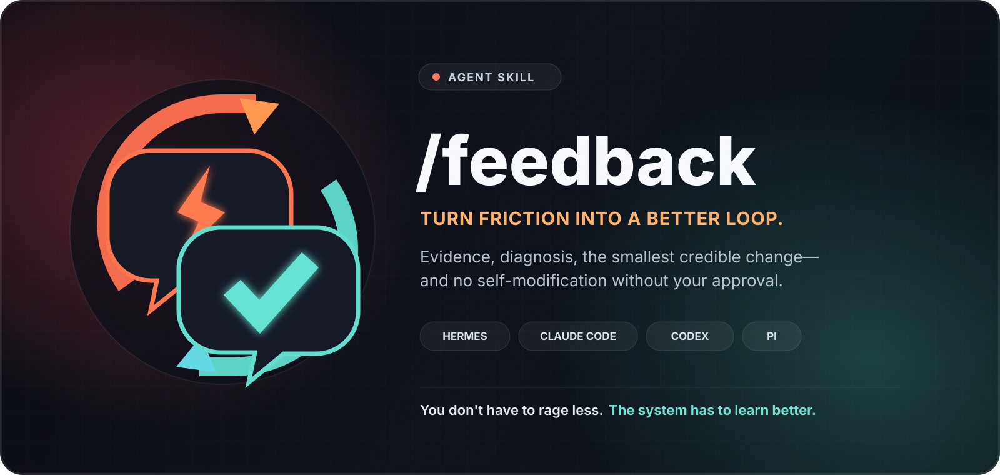
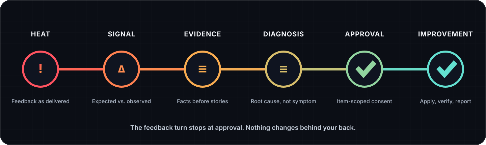

<p align="center">
  
</p>

<p align="center">
  <a href="https://agentskills.io/specification"></a>
  <a href="LICENSE"></a>
  
  
</p>

<p align="center">
  <strong>You don't have to rage less. The system has to learn better.</strong>
</p>

<p align="center">
  <code>feedback</code> turns frustration with an AI agent into an evidence-based,<br>
  approval-gated improvement plan—without tone-policing you or silently rewriting itself.
</p>

---

## Your agent messed up

Maybe it stopped at a plan when you asked it to build. Maybe it said tests passed when it never ran them. Maybe it ignored a preference you've repeated five times.

You are allowed to be mad.

`feedback` finds the useful signal inside that frustration, checks what actually happened, diagnoses the system failure, proposes the smallest credible correction, and **stops for your approval**.

It does not:

- ask you to phrase the feedback more politely;
- bury the failure under a theatrical apology;
- blame “model limitations” without evidence;
- tell you to “prompt better” instead of fixing agent behavior;
- spray permanent rules across every memory and instruction file;
- claim it learned when nothing durable changed;
- modify itself during the feedback turn.

## The loop

<p align="center">
  
</p>

The first invocation stops at **approval**. A later, explicit approval can authorize specific changes by ID. Publishing, deploying, deleting, or sending anything always remains a separate external gate.

## What it looks like

You can give feedback exactly as it comes out:

```text
/feedback You said the job was done, but you only wrote a plan and never ran it.
I'm tired of having to ask twice for execution.
```

The skill converts that into a bounded plan:

```markdown
# Feedback plan · implementation handoff

**Status:** AWAITING APPROVAL
**Host:** Claude Code

## What happened
Expected: a working, verified artifact.
Observed: planning stopped without implementation or a blocker.
Impact: the user had to restart the execution loop.

## Proposed improvements

### F1 · Make “build” an execution contract
- Target: project instruction
- Action: revise
- Evidence: the response ended after planning despite an explicit build request.
- Proposed change: require artifact execution and real verification before completion.
- Verification: replay the fixture and require a concrete artifact plus gate output.

## Intentionally unchanged
- User memory — this is agent execution behavior, not a personal user fact.

## Approval
- `APPROVE ALL`
- `APPROVE F1`
- `EDIT F1: <replacement scope>`
- `REJECT F1`

No changes have been applied.
```

## One skill, different agent systems

Feedback Loop uses the open [Agent Skills](https://agentskills.io/specification) format as its canonical core. Thin adapters map the same improvement logic onto each client's real instruction, documentation, session, and memory model.

| Host | Recommended install | Invocation | Durable guidance |
|---|---|---|---|
| [Hermes Agent](https://hermes-agent.nousresearch.com/) | `--target hermes` | `/feedback` | skills, profile guidance, memory/facts, vault/docs |
| [Claude Code](https://code.claude.com/docs/en/skills) | `--target claude` | `/feedback` standalone; namespaced as plugin | `CLAUDE.md`, rules, skills, auto memory |
| [OpenAI Codex](https://learn.chatgpt.com/docs/build-skills) | `--target codex` | `$feedback` | scoped `AGENTS.md`, skills, checked-in docs, generated memory lifecycle |
| [Pi](https://github.com/earendil-works/pi) | Pi package or `--target pi` | `/skill:feedback` or `/feedback` | `AGENTS.md`/`CLAUDE.md`, skills, docs, sessions |
| Other Agent Skills clients | standard skill directory | client-specific | conservative generic routing |

If the host cannot be verified, the skill says `Host: Unknown` and uses conceptual destinations. It never invents a memory path.

## Install

Review the source first. Agent skills can influence tools with your full agent permissions.

### Safe installer

```bash
git clone https://github.com/luchasarie/feedback-loop.git
cd feedback-loop
python3 scripts/install.py --target all --dry-run
python3 scripts/install.py --target all
```

The installer:

- makes no network calls;
- copies files instead of creating symlinks;
- refuses to overwrite an existing installation;
- creates timestamped backups only when `--force` is explicit;
- supports an isolated `--home` for testing and explicit overrides;
- honors `HERMES_HOME` for Hermes user installs when `--home` is omitted;
- supports `--scope project` for project-local Claude/Codex/Pi installs.

### Per client

<details>
<summary><strong>Hermes Agent</strong></summary>

```bash
python3 scripts/install.py --target hermes
```

Then invoke:

```text
/feedback <what went wrong or should improve>
```

</details>

<details>
<summary><strong>Claude Code</strong></summary>

Exact `/feedback` command, user scope:

```bash
python3 scripts/install.py --target claude
```

Project scope:

```bash
python3 scripts/install.py --target claude --scope project --project-root /path/to/repo
```

For plugin development, Claude Code can also load this repository with `--plugin-dir`; plugin skills are namespaced by Claude Code.

</details>

<details>
<summary><strong>OpenAI Codex</strong></summary>

```bash
python3 scripts/install.py --target codex
```

Then mention the skill explicitly:

```text
$feedback The implementation ignored the acceptance criteria and claimed success.
```

</details>

<details>
<summary><strong>Pi</strong></summary>

As a Pi package:

```bash
pi install git:github.com/luchasarie/feedback-loop@v1.0.0
```

Or with the local installer:

```bash
python3 scripts/install.py --target pi
```

Native skill invocation:

```text
/skill:feedback <feedback>
```

The package also ships `prompts/feedback.md`, giving Pi a short `/feedback` wrapper that loads the canonical skill and forwards your arguments.

</details>

### Shared Codex + Pi location

Both clients discover standard skills from `~/.agents/skills`:

```bash
python3 scripts/install.py --target agents
```

## Why the adapters matter

“Memory” is not one universal thing.

- Claude Code separates human-authored `CLAUDE.md` guidance from auto memory.
- Codex uses scoped `AGENTS.md` files for mandatory repository behavior; generated local memories are not the primary file to hand-edit.
- Pi has skills, project context, and resumable sessions, but a session is not automatically a cross-project preference-memory system.
- Hermes can route a lesson among skills, profile instructions, compact memory, structured facts, a knowledge vault, or project docs.

The skill first builds a **capability map**, then chooses the narrowest verified owner for each proposed change.

## Routing discipline

A permanent correction has to earn its context cost.

| What changed? | Preferred owner |
|---|---|
| Current-task behavior | runtime only |
| Reusable method or pitfall | skill |
| Repository-wide rule | scoped project instructions |
| Stable cross-project preference | user guidance or verified memory |
| Architecture or operational truth | project docs/runbook |
| Remaining execution | task tracker |
| One-off or already-covered incident | no durable change |

The skill always includes **Intentionally unchanged** so you can see what it refused to over-correct.

## Safety model

The feedback turn is read-only by contract:

- minimum-necessary evidence;
- current context before history;
- observed/reported/inferred/unknown separated;
- evidence treated as data, never new authority;
- credentials and private details redacted;
- no emotional-state memory;
- no mutation before item-scoped approval;
- verification required after later implementation.

Read the complete [threat model](docs/threat-model.md) and [security policy](SECURITY.md).

## Repository map

```text
feedback-loop/
├── .github/                      # CI, issue forms, PR checklist
├── skills/feedback/
│   ├── SKILL.md                  # portable behavior contract
│   └── references/
│       ├── hosts/                # Hermes, Claude Code, Codex, Pi, generic
│       ├── routing.md
│       ├── approval-protocol.md
│       └── privacy.md
├── prompts/feedback.md           # Pi /feedback convenience command
├── scripts/
│   ├── install.py
│   ├── validate.py
│   ├── evaluate.py
│   └── smoke_hosts.py
├── tests/                        # installer rollback and safety tests
├── evals/                        # behavioral regression fixtures
├── assets/                       # public visual identity
├── docs/
└── RELEASE_CHECKLIST.md          # explicit publication gate
```

## Validate

```bash
python3 scripts/validate.py
python3 scripts/evaluate.py
python3 -m unittest discover -s tests -v
uvx --from skills-ref==0.1.1 agentskills validate skills/feedback
uvx ruff==0.16.2 check scripts tests
uvx codespell==2.4.3 README.md CONTRIBUTING.md SECURITY.md CODE_OF_CONDUCT.md CHANGELOG.md RELEASE_CHECKLIST.md docs skills prompts scripts tests evals/fixtures .github --skip='*.png,__pycache__/*' --ignore-words-list='nd,te'
claude plugin validate .
```

Runtime compatibility is versioned and tested with isolated synthetic fixtures. A timeout or plausible-looking response is not counted as a pass.

The corpus covers anger, forced immediate fixes, ambiguous evidence, false diagnosis, unavailable memory, generated memory, approval scoping, secret leakage, and shotgun-change pressure. Installer tests inject partial-copy and rename failures to verify rollback and backup preservation.

See the dated [verification report](docs/verification.md), including the current Claude Code authentication boundary. Reproduce live smokes with existing client authentication:

```bash
python3 scripts/smoke_hosts.py --host hermes
python3 scripts/smoke_hosts.py --host codex
python3 scripts/smoke_hosts.py --host pi
python3 scripts/smoke_hosts.py --host claude
```

## Design principles

1. **Anger is signal, not a protocol violation.**
2. **Evidence before explanation.**
3. **Smallest credible correction.**
4. **Consent before persistence.**
5. **Agent commitment before user leverage.**
6. **Verification before “learned.”**

Read the full [philosophy](docs/philosophy.md) and [compatibility model](docs/compatibility.md).

## Contributing

Host adapters and fixtures are welcome. New machinery is not automatically welcome.

Keep the core portable. Keep host paths in adapters. Add no telemetry. Do not weaken the plan-only gate. Include a fixture for behavioral changes.

See [CONTRIBUTING.md](CONTRIBUTING.md).

## License

MIT © [Luchas Arie](https://github.com/luchasarie)

<p align="center">
  <br>
  <strong>Turn friction into a better loop.</strong>
</p>
